<p align="center">
  
</p>

<h1 align="center">Pawchive</h1>

<p align="center">
  <a href="README.md">简体中文</a> | <a href="README.ja.md">日本語</a>
</p>

<p align="center">
  A polished, fluid third-party Android client that brings you the full <a href="https://pawchive.pw">Pawchive</a> platform experience.<br/>
  Aggregates creator content from Patreon, Fanbox, Discord and more — browse, search, bookmark, and enjoy immersive media playback.
</p>

<p align="center">
  
  
  
  
  
  <a href="https://t.me/Pawchive_Archive"></a>
  <a href="https://github.com/Aerunox/Archive"></a>
</p>

> [!IMPORTANT]
> 🚀 **Next generation**: Pawchive 1.9.0 is the **final release** of this repository. The project is end-of-life (EOL) — no further bug fixes or security patches will be published. Development has moved to the next-generation repository **[Aerunox/Archive](https://github.com/Aerunox/Archive)** — head over and give it a star!
>
> 📢 **Telegram channel**: Join [Pawchive Archive](https://t.me/Pawchive_Archive) for release announcements and project updates.

> [!NOTE]
> This is an **unofficial third-party client** with no affiliation or partnership with the operators of `pawchive.pw`. The app neither hosts nor distributes any content — it is only a browsing and downloading tool. All content rights belong to the original creators and their respective platforms. Breakage caused by upstream API changes is outside the support commitment.

---

## Feature Highlights

### Content Browsing
- **Home feed**: paginated latest content with keyword filtering; optional "one post per creator" and "hide posts from bookmarked creators"
- **Creator profile**: paginated Posts / Announcements / Linked accounts / Similar creators (swipe left/right to switch), tag filtering, fan-card overview
- **Post details**: full body (allow-listed HTML rendering), comments, revision history, attachment downloads
- **Multi-platform aggregation**: sources such as Patreon / Fanbox / Discord, platform tags color-coded by brand

### Precise Search
- **Keyword search**: searches posts and creators simultaneously, switch via tabs
- **Reverse file-hash lookup**: paste a file hash (MD5 / SHA-256) into the search box to trace asset origins; Discord results supported
- **Offline full-text search**: Room FTS4 index with Chinese tokenization — search your bookmarks even without a network
- **Search history**: persisted locally, configurable retention (5–50), delete individual entries or clear all at once

### Immersive Media
- **Large image viewer**: pinch zoom, double-tap zoom, boundary-constrained panning
- **Animated images**: GIF / animated WebP / animated HEIF, with a "GIF" corner badge in lists
- **Video playback**: Media3 ExoPlayer with Bilibili-style controls, playback speed, resume from last position; fullscreen and inline share a single player instance — zero re-buffering when entering/exiting fullscreen, aspect-ratio-preserving scaling
- **Multi-level fallback**: original image first, automatically falls back to the thumbnail when missing

### Bookmarks & Accounts
- **Multi-account switching**: bookmarks / history / downloads isolated per account
- **Cloud bookmarks**: sync bookmarked posts and creators after login, cache invalidated immediately on write; offline operations are queued automatically and replayed in the background once back online
- **Local bookmarks**: no login required — bookmarking instantly builds an offline archive index
- **Offline reading**: full-text archiving of bookmarked posts (Room FTS4), searchable and readable offline

### Subscriptions & Notifications
- **Subscribe to creators**: follow your favorite creators; new posts are checked periodically (configurable interval, minimum 15 minutes); optional "bookmark = subscribe"
- **System notifications**: instant push when new posts are detected, can be turned off anytime
- **In-app notification center**: one tap from the home bell, live unread-count badge; mark one/all as read, unsubscribe anytime from the subscription manager

### Download Center
- **HTTP Range resumable downloads**: pausing keeps the temp file, breakpoints are persisted to the database, and downloads resume from the breakpoint even after an app restart; automatically falls back to a full download when the server does not support Range
- **Per-task notifications**: one notification per task showing percentage / downloaded size / speed (EMA-smoothed) / ETA in real time; pause, resume, or cancel right from the notification
- **Persistent background downloads**: kept alive by a `dataSync` foreground service — backgrounding the app never interrupts them
- **Download rules**: auto-enqueue by creator / service / file type
- **Compliance constraints**: concurrency hard-capped at 5, ≥1 s retry spacing per file, custom identifiable User-Agent

### Personalization
- **Multi-language**: 中文 / English / 日本語, live switching
- **Appearance**: light / dark / follow system, a default theme plus 5 accent themes (6 color schemes in total), Material Design 3; dynamic color on Android 12+ (Material You); immersive status bar
- **Display & scaling**: global UI-scale and font-size sliders with live preview, applied instantly; grid columns (1–3); all motion can be disabled
- **Data saver**: lists load thumbnails by default, switchable to originals
- **Download settings**: custom download directory (SAF), max concurrency (1–5), retries (1–3), Wi-Fi-only downloads, file naming format
- **Auto backup**: daily backup export to a directory of your choice
- **In-app updates**: 1.9.0 is the final version; updates have ended and the whole GitHub update-check chain has been removed

---

## Tech Stack

| Category | Choice | Notes |
|------|---------|------|
| **Language** | Kotlin | Bundled with AGP 9.3.2 — no separate Kotlin Gradle plugin needed; JVM 17 bytecode target |
| **Min SDK** | API 30 (Android 11) | Covers the vast majority of active devices |
| **Target / compile SDK** | API 36 (minorApiLevel 1) | Latest Android release |
| **UI framework** | XML + ViewBinding | Declarative layouts, type-safe access (not Compose) |
| **Design language** | Material Design 3 | Card grouping, segmented buttons, brand-colored tags, dynamic color |
| **Modularization** | 10 Gradle modules | `app` / 7×`feature-*` / `data` / `core` |
| **Dependency injection** | Hilt 2.59.2 + KSP 2.3.6 | `@HiltAndroidApp` / `@AndroidEntryPoint` / `HiltWorkerFactory` |
| **Local storage** | Room 2.8.4 + DataStore 1.1.1 | Room for download history / offline archive FTS4, DataStore for settings |
| **Secure storage** | security-crypto 1.1.0 | `EncryptedSharedPreferences` for `cf_clearance` and session credentials |
| **Download engine** | In-house OkHttp streaming downloader | Replaced okdownload since 1.7.0; single connection, single request + Range resume |
| **Networking** | Retrofit 2.9.0 + OkHttp 4.12.0 | Type-safe HTTP client + custom interceptor chain |
| **Image loading** | Coil 2.6.0 + coil-gif | Coroutine-native; `ImageDecoderDecoder` registered for animated images |
| **Video playback** | AndroidX Media3 1.4.1 | ExoPlayer + OkHttp data source |
| **Navigation** | Single Activity + ViewPager2 1.1.0 | Bottom navigation and swipe gestures stay in sync both ways |
| **Background work** | WorkManager 2.12.0 + Hilt | Periodic subscription sync, auto backup, cache cleanup |
| **Build tooling** | Gradle 9.5.1 + AGP 9.3.2 | Centrally managed via the version catalog (`libs.versions.toml`) |
| **Quality gate** | Kover 0.9.9 | Core layers (core + data) line coverage ≥ 45% |

### Architecture Overview

Module collaboration & data-flow diagram:

```mermaid
flowchart TD

subgraph group_ui["Assembly and feature layers"]
  node_app["Main app<br/>[MainActivity.kt]"]
  node_home["Home feed<br/>[HomeFragment.kt]"]
  node_search["Search UI<br/>[SearchFragment.kt]"]
  node_post["Post details"]
  node_account["Account and creator<br/>[AccountFragment.kt]"]
  node_settings["Settings"]
  node_downloads_ui["Download center UI"]
end

subgraph group_content["Content access"]
  node_api["Platform API<br/>[PawchiveApi.kt]"]
  node_clearance["Clearance and credentials"]
  node_offline[("Offline search")]
end

subgraph group_library["Bookmarks and archive"]
  node_archive["Offline archive"]
  node_bookmarks["Bookmarks<br/>[BookmarkManager.kt]"]
  node_session[("Account sessions<br/>[SessionManager.kt]")]
  node_subscriptions["Creator subscriptions"]
end

subgraph group_operations["Background operations"]
  node_rules["Download rules"]
  node_enqueue["Download enqueue"]
  node_download["Download execution<br/>[DownloadCenter.kt]"]
  node_http_download["HTTP transfer"]
  node_notifications["Download notifications"]
  node_download_service["Foreground service"]
  node_workers["Scheduled work"]
end

subgraph group_platform["Infrastructure"]
  node_settings_store[("Preferences<br/>[SettingsManager.kt]")]
  node_database[("Room database")]
end

node_user(("App user"))
node_creator_service{{"pawchive.pw platform"}}
node_android{{"Android system"}}

node_user -->|"launches"| node_app
node_app -->|"shows tab"| node_home
node_app -->|"shows tab"| node_search
node_app -->|"shows tab"| node_downloads_ui
node_user -->|"opens content"| node_post
node_user -->|"manages account"| node_account
node_user -->|"configures"| node_settings
node_home -->|"loads feed"| node_api
node_search -->|"searches online"| node_api
node_api -->|"requests content"| node_creator_service
node_api -->|"obtains clearance"| node_clearance
node_search -->|"searches archive"| node_offline
node_post -->|"saves content"| node_bookmarks
node_bookmarks -->|"indexes saved posts"| node_archive
node_archive -->|"stores archive"| node_database
node_offline -->|"queries index"| node_database
node_account -->|"manages sessions"| node_session
node_settings -->|"manages subscriptions"| node_subscriptions
node_subscriptions -->|"persists subscriptions"| node_database
node_post -->|"applies rules"| node_rules
node_rules -->|"enqueues matches"| node_enqueue
node_enqueue -->|"adds tasks"| node_download
node_download -->|"transfers files"| node_http_download
node_http_download -->|"writes files"| node_android
node_download -->|"updates progress"| node_notifications
node_notifications -->|"starts service"| node_download_service
node_download_service -->|"forwards actions"| node_download
node_downloads_ui -->|"manages tasks"| node_download
node_workers -->|"checks creators"| node_subscriptions
node_workers -->|"schedules work"| node_android
node_settings -->|"reads and writes"| node_settings_store

classDef toneNeutral fill:#f8fafc,stroke:#334155,stroke-width:1.5px,color:#0f172a
classDef toneBlue fill:#dbeafe,stroke:#2563eb,stroke-width:1.5px,color:#172554
classDef toneAmber fill:#fef3c7,stroke:#d97706,stroke-width:1.5px,color:#78350f
classDef toneMint fill:#dcfce7,stroke:#16a34a,stroke-width:1.5px,color:#14532d
classDef toneRose fill:#ffe4e6,stroke:#e11d48,stroke-width:1.5px,color:#881337
classDef toneIndigo fill:#e0e7ff,stroke:#4f46e5,stroke-width:1.5px,color:#312e81
classDef toneTeal fill:#ccfbf1,stroke:#0f766e,stroke-width:1.5px,color:#134e4a
class node_app,node_home,node_search,node_post,node_account,node_settings,node_downloads_ui,node_user toneBlue
class node_api,node_clearance,node_offline toneAmber
class node_archive,node_bookmarks,node_session,node_subscriptions toneMint
class node_rules,node_enqueue,node_download,node_http_download,node_notifications,node_download_service,node_workers toneRose
class node_settings_store,node_database,node_creator_service,node_android toneIndigo
```



---

## Core Technical Highlights

### 1. Automatic Cloudflare Managed-Challenge Clearance

The target site is protected by Cloudflare — plain OkHttp requests are blocked with 403. `CloudflareManager` runs the JS challenge in a hidden WebView, extracts the `cf_clearance` cookie, and injects it **together with its bound User-Agent** into all subsequent OkHttp requests:

- **Single-flight**: concurrent callers reuse the same `CompletableDeferred` — never spawns multiple WebViews in parallel
- **Credential persistence**: credentials kept in encrypted storage (EncryptedSharedPreferences); cold starts within the 25-minute TTL skip the challenge
- **`session` segment forcibly stripped**: the anonymous session written by the WebView would stack with the real login session and cause false 401s, so it is always removed before injection
- **Hardening**: construction and configuration wrapped in wholesale graceful degradation (even a third-party WebView throwing `Error` won't crash the app); `onRenderProcessGone` overridden so a renderer crash doesn't take the app down with it

### 2. Direct OkHttp Streaming Download Engine

okdownload was removed in 1.7.0 (source-level findings: sync-thread blocking without timeouts, multi-chunk concurrent requests violating server rate limits, breakpoint validation throwing cryptic errors on truncated responses) in favor of single-connection streaming downloads:

- **Pause / resume**: pausing keeps the temp file; resuming sends `Range: bytes=N-`; silently falls back to a full download when the server ignores Range and returns 200
- **Truncation detection**: compares `Content-Length` with the bytes actually read; fails fast on truncated responses and retries with backoff
- **Cancellable**: the read loop checks coroutine activeness every 64 KB, so cancellation interrupts both the download and write-out phases immediately
- **Temp-file isolation**: writes to a temp file first, then copies to the target stream in one shot on success — retries never pollute bytes already written
- **Four separated client types**: the download client has no `callTimeout` (otherwise files that take over 60 s would be killed by the watchdog) and carries no in-memory cache interceptor

### 3. Smart Interceptor Chain

- **Credential injection**: Cookie + Referer + UA are injected only for the main domain `pawchive.pw`; CDN subdomains get the UA only (avoids tripping hotlink protection and leaking credentials)
- **403 fallback**: `ClearanceRetryInterceptor` force-refreshes the clearance on 403 and retries once
- **Log redaction**: `Authorization` / `Cookie` / `Set-Cookie` are always masked; logging is off in release builds
- **Account-scoped caching**: GET JSON responses cached for 5 minutes, keys namespaced by session hash (no cross-account reuse), with precise per-path invalidation

### 4. Single Activity + Modular Navigation

- Bottom navigation and **ViewPager2** sync both ways — main tabs follow your finger as you swipe
- `offscreenPageLimit = 1`: prevents the home and bookmarks pages from preloading simultaneously and racing the same clearance task
- **AppNavigator interface**: features navigate through the interface — zero direct dependencies between modules

### 5. Offline Archive & Full-Text Search

- Bookmarking writes the Room entity table + FTS4 shadow table, with a transaction keeping both consistent
- **CJK bigram tokenization**: Chinese matches without spaces
- **Relevance weighting**: title > creator > body/attachments; tiered retrieval merged and deduplicated in weight order

### 6. Performance & UX

- **Skeleton screens**: custom `SkeletonHelper` shimmer pulse animation, globally disableable (reduce motion)
- **Zero-blocking startup path**: language / appearance / scaling read from a lightweight SharedPreferences startup cache — DataStore is never touched
- **In-memory snapshot + async persistence**: settings and bookmarks read from memory and write asynchronously — the UI responds instantly

---

## Project Structure

```
Pawchive/
├── app/                    # Assembly layer: Application / MainActivity / main pager
├── feature-common/         # Shared UI: SkeletonHelper / ZoomableImageView / common adapters / AppNavigator
├── feature-home/           # Home feed
├── feature-search/         # Search (online + offline full-text)
├── feature-post/           # Post details / large image viewer / video playback
├── feature-downloads/      # Download center
├── feature-settings/       # Settings (download rules, subscriptions, backup, cache management)
├── feature-account/        # Account / login / bookmarks
├── data/                   # Business layer: repositories / download engine / workers
├── core/                   # Infrastructure: networking / models / Room / DataStore / utilities
└── gradle/libs.versions.toml   # Version catalog (single source of truth for dependencies)
```

**Dependency direction**: `:app` → `:feature-*` → `:data` → `:core`

By the numbers: 150 Kotlin source files (~27k lines), 42 layout files, 27 unit test classes + 1 instrumentation suite.

---

## Quick Start

### Requirements
- **Android Studio** Meerkat (2024.3+) or newer
- **JDK** 17 (`compileOptions` sets `sourceCompatibility` / `targetCompatibility` to `VERSION_17`; no module script declares `jvmTarget` — the Kotlin bytecode target comes from the Kotlin compiler bundled with AGP 9.3.2)
- **Gradle** 9.5.1 (wrapper included, with `distributionSha256Sum` integrity verification — no manual install needed)

### Clone & Build

```bash
git clone https://github.com/Aerunox/Pawchive.git
cd Pawchive
./gradlew assembleRelease
```

> APK output path: `app/build/outputs/apk/release/Pawchive-v<version>.apk`
> (The filename comes from `VERSION_NAME` in `gradle.properties` — the single source of truth for the version number; the build fails outright if it is missing or invalid.)
>
> Without a `keystore.properties` file, the release variant falls back to debug signing so you can build locally; supply your own keystore for official distribution.

### Common Tasks

```bash
./gradlew testDebugUnitTest                       # Unit tests
./gradlew koverVerify koverHtmlReport             # Coverage gate & report
./gradlew lintDebug                               # Lint
```

### Installation

Download the latest APK ([Releases · v1.9.0](https://github.com/Aerunox/Pawchive/releases/tag/v1.9.0)) and install it on an Android 11+ device.

---

## Permissions

| Permission | Purpose |
|------|------|
| `INTERNET` | Network requests |
| `ACCESS_NETWORK_STATE` | Network state detection (Wi-Fi-only downloads, connectivity checks) |
| `POST_NOTIFICATIONS` | Download progress and content update notifications (runtime request on Android 13+; downloads and browsing are unaffected if denied) |
| `FOREGROUND_SERVICE` | Download foreground service |
| `FOREGROUND_SERVICE_DATA_SYNC` | Download foreground service type (mandatory declaration on Android 14+ to keep background downloads alive) |
| `WRITE_EXTERNAL_STORAGE` | Declared only on API ≤ 28; newer systems use MediaStore / SAF and don't need it |
| `ACCESS_MEDIA_LOCATION` | Declared only on API ≤ 32; reads media location metadata |

---

## Engineering Quality

| Mechanism | Description |
|------|------|
| **Single version source** | `VERSION_NAME` / `VERSION_CODE` in `gradle.properties` are the only version source: `:app` enforces them via `requireNotNull` (missing or invalid values fail the build, no fallback), and `:feature-common` shares the same properties via `buildConfigField` |
| **Single dependency source** | Dependency versions live in the `gradle/libs.versions.toml` version catalog |
| **Coverage ratchet** | Core layers (core + data) line coverage floor of 45% — only goes up; `./gradlew koverVerify` fails if it drops |
| **Reproducible builds** | Gradle wrapper pinned to 9.5.1 with `distributionSha256Sum` verification; mirror repositories are preferred to work around TLS handshake failures on the official sources |
| **R8 obfuscation & resource shrinking** | Release builds enable `isMinifyEnabled` + `isShrinkResources`; `mapping.txt` is written to `app/build/outputs/mapping/release/` for deobfuscating production crashes |
| **Signing fallback** | Uses the release keystore when `keystore.properties` exists, otherwise falls back to debug signing so external contributors can build |
| **Static analysis** | `lintDebug`; `app/src/main/lint.xml` opts in to Media3 `UnstableApi` globally and disables only `UnsafeOptInUsageError` |
| **Automated tests** | 27 unit test classes (core 15 / data 12) + 1 instrumentation suite, powered by Robolectric 4.14.1 |
| **Crash diagnostics** | Global `CrashHandler` writes crash logs to disk, exportable via FileProvider sharing |
| **Trilingual alignment** | String keys in `core` / `data` / `feature-common` are fully aligned across `values/`, `values-en/`, `values-ja/` (449 / 29 / 15 entries) |

---

## Known Boundaries

The following limitations are design decisions or platform constraints and are not treated as defects:

1. **Android 15+ foreground-service time cap**: `dataSync` foreground services are subject to the system's "6 hours accumulated per 24 hours" limit; very long downloads get interrupted by the system and must be resumed manually
2. **WebView content ignores in-app scaling**: the UI-scale setting applies to native surfaces; web content uses its own viewport density
3. **Upstream service changes**: this app does not control the API or anti-bot policy of `pawchive.pw`; unilateral upstream changes may break features

---

## Support & Security

| Document | Contents |
|------|------|
| [SUPPORT.md](SUPPORT.md) | Support window, update cadence, system requirements, known boundaries, EOL policy |
| [SECURITY.md](SECURITY.md) | Vulnerability reporting channels, response times, security design notes |
| [CHANGELOG.md](CHANGELOG.md) | Release history |
| [NOTICE.md](NOTICE.md) | Third-party components and license notices |

> ⚠️ Since 1.9.0 the project is end-of-life (EOL): no further bug or security fixes, and the in-app update check has been removed. Existing users can keep using it and install the APK from the Releases page manually.

---

## Community & What's Next

| Channel | Description |
| --- | --- |
| [Telegram channel · Pawchive Archive](https://t.me/Pawchive_Archive) | Release announcements and project updates |
| [Next-generation repository · Aerunox/Archive](https://github.com/Aerunox/Archive) | The next generation of this project — future development and updates happen here |

---

## Contributing

Issues and pull requests are welcome. Before submitting, please make sure:

1. Code style is consistent with the existing code (`kotlin.code.style=official`)
2. New strings cover all three resource languages (keys must stay aligned across `values/`, `values-en/`, `values-ja/` in `core` / `data` / `feature-common`)
3. Material Design 3 guidelines are followed
4. New core-layer logic comes with unit tests and does not drop coverage below the gate

---

## License

This project is open-sourced under the **MIT License**, Copyright (c) 2024-2026 FengByX. Third-party components and icon licenses are listed in [NOTICE.md](NOTICE.md).

---

<p align="center">
  <sub>Icons from <a href="https://lucide.dev">Lucide</a> · Design inspired by Material Design 3</sub>
</p>
