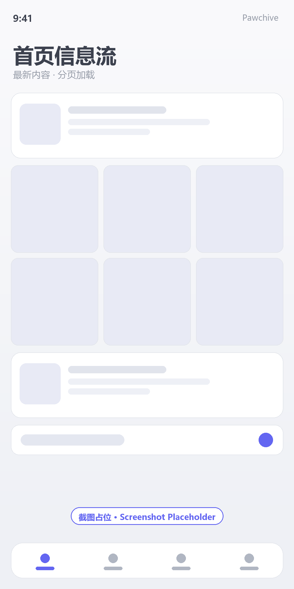
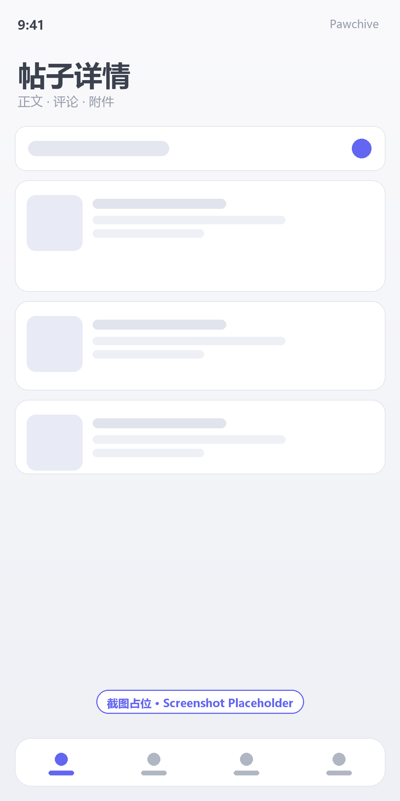
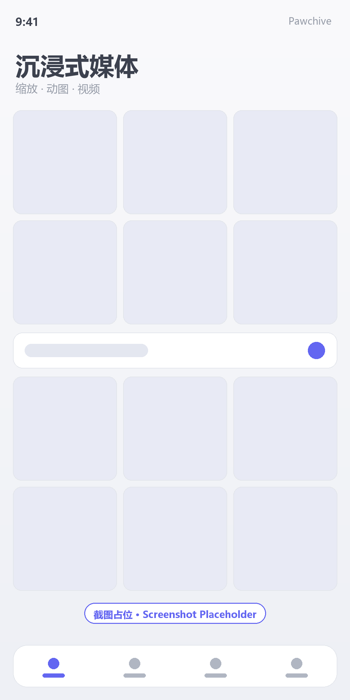
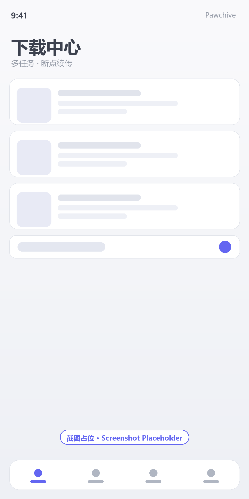
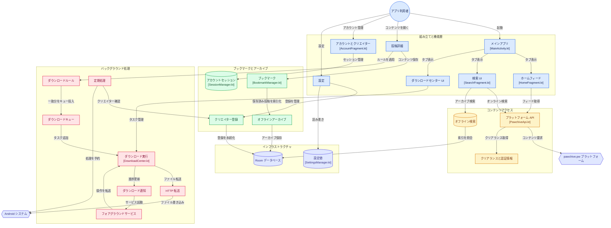

<p align="center">
  
</p>

<h1 align="center">Pawchive</h1>

<p align="center">
  <a href="README.md">简体中文</a> | <a href="README.en.md">English</a>
</p>

<p align="center">
  <b>究極の軽量・シンプルさ</b>を核としたサードパーティ製 Android クライアント。Patreon・Fanbox・Discord など複数プラットフォームのクリエイター投稿を集約します。<br/>
  機能範囲は意図的に絞り込み、無駄な依存はゼロ。インストールサイズは約 15 MB で、閲覧・検索・ブックマーク・没入型メディア再生に集中します。
</p>

<p align="center">
  
  
</p>

<p align="center">
  
  
  
  
  
  <a href="https://t.me/Pawchive_Archive"></a>
  <a href="https://github.com/Aerunox/Archive"></a>
</p>

> [!IMPORTANT]
> 🚀 **次世代プロジェクト**: Pawchive 1.9.0 は本リポジトリの**最終リリース**です。プロジェクトは EOL（開発終了）となり、今後のバグ修正・セキュリティ修正は提供されません。開発は次世代リポジトリ **[Aerunox/Archive](https://github.com/Aerunox/Archive)** に移行しました。ぜひスターをお願いします！
>
> 📢 **Telegram チャンネル**: リリース情報やプロジェクトの最新情報は [Pawchive Archive](https://t.me/Pawchive_Archive) でお知らせします。

> [!NOTE]
> 本アプリは `pawchive.pw` の運営元とは一切関係のない**非公式のサードパーティ製クライアント**です。アプリ自体はコンテンツを保有・配信せず、閲覧とダウンロードのためのツールにすぎません。コンテンツに関する権利はすべて原著作者および各プラットフォームに帰属します。上流 API の変更に起因する不具合はサポート対象外です。

> [!TIP]
> **本プロジェクトと [Aerunox/Archive](https://github.com/Aerunox/Archive) は単純な新旧バージョンの関係ではなく、設計思想の異なる 2 つの製品ラインです**：Pawchive は**究極の軽量・シンプル**を、Archive は**機能の豊富さ**を追求します。「小さく速い」か「大きく全部入り」か、重視するものに応じて選んでください。詳細は下記の[設計思想と比較](#設計思想pawchive-vs-archive)をご覧ください。

---

## 設計思想：Pawchive vs Archive

両プロジェクトは源流を同じくしますが、設計目標は正反対です。Pawchive は**引き算**の産物、Archive は**足し算**の産物です。

| 観点 | **Pawchive**（本リポジトリ） | **[Archive](https://github.com/Aerunox/Archive)** |
| --- | --- | --- |
| **設計思想** | 🪶 究極の軽量・シンプル | 🧰 機能豊富で全部入り |
| **基本方針** | 高頻度の機能だけを残し、低頻度の要望にサイズと認知コストを払わない | できるだけ多くの利用シーンをカバーし、機能密度を優先 |
| **UI フレームワーク** | XML + ViewBinding、Material Design 3 | Jetpack Compose + Miuix（HyperOS 風） |
| **モジュール構成** | Gradle 10 モジュール、`feature-*` ごとに分割 | Gradle 3 モジュール（`app` / `data` / `core`） |
| **コード規模** | Kotlin 150 ファイル・約 2.7 万行 | Kotlin 188 ファイル・約 3.5 万行 |
| **依存ライブラリ数** | 37 | 47 |
| **パッケージサイズ** | 約 **15 MB**（universal 単一 APK） | 約 **35〜97 MB**（ABI 別分割、universal は約 97 MB） |
| **AI 機能** | ❌ 非搭載 | ✅ 複数プロバイダーの AI、モデルプロファイル、翻訳・画像認識 |
| **OCR 文字認識** | ❌ 非搭載 | ✅ オンデバイス PP-OCRv4（ONNX Runtime） |
| **多言語対応** | 簡体中文／English／日本語（3 言語） | 12 言語を完全ローカライズ（アラビア語の RTL 含む） |
| **外観カスタマイズ** | 既定 + 5 種のアクセントカラー、Material You ダイナミックカラー | 配色 6 種、Monet ダイナミックカラー + シードカラー、即時切替 |
| **アプリ内アップデート** | ❌ 1.9.0 で削除 | ✅ GitHub Release を参照する更新チェックを内蔵 |
| **プロジェクト状況** | 🔒 1.9.0 が最終版・EOL | 🚀 継続開発中 |
| **ライセンス** | MIT | GPL-3.0 |

> 上記の数値はすべて各リポジトリの実際のビルド設定とリリース成果物に基づくものです（Pawchive 1.9.0 / Archive 1.0.2）。推定値は含みません。

**どちらを選ぶ？**

- **インストールしてすぐ使え、容量を取らない閲覧ツール**が欲しい → **Pawchive**
- **OCR・AI 翻訳・12 言語 UI・Monet による深いカスタマイズ**が欲しい → **[Archive](https://github.com/Aerunox/Archive)**

---

## スクリーンショット

<p align="center">
  
  
  
  
</p>

<p align="center">
  <sub>ホームフィード · 投稿詳細 · 没入型メディア · ダウンロード</sub>
</p>

> 画像は `docs/screenshots/` にあり、現在は**プレースホルダー**です。実機のスクリーンショットに差し替える場合は、同じファイル名・同じアスペクト比（1080 × 2160 推奨）で上書きすれば、本ファイルの編集は不要です。

---

## 機能ハイライト

### コンテンツ閲覧
- **ホームフィード**：キーワード絞り込みに対応した最新投稿のページング表示。「クリエイターごとに 1 件のみ表示」「ブックマーク済みクリエイターの投稿を非表示」も選択可能
- **クリエイターページ**：投稿／お知らせ／関連アカウント／類似クリエイターをページング表示（左右スワイプで切り替え）、タグ絞り込み、ファンカード概要
- **投稿詳細**：本文全体（許可リスト方式の HTML レンダリング）、コメント、更新履歴、添付ファイルのダウンロード
- **マルチプラットフォーム集約**：Patreon／Fanbox／Discord などのソースに対応し、プラットフォームタグはブランドカラーで色分け

### 精密検索
- **キーワード検索**：投稿とクリエイターを同時に検索し、タブで切り替え
- **ファイルハッシュ逆引き**：検索ボックスにファイルハッシュ（MD5／SHA-256）を貼り付けると素材の出所を追跡。Discord の結果にも対応
- **オフライン全文検索**：Room FTS4 インデックスと中国語分かち書きにより、ネットワークなしでもブックマークを検索可能
- **検索履歴**：端末内に保存され、保持件数（5〜50 件）を設定可能。個別削除・一括削除にも対応

### 没入型メディア
- **大型画像ビューア**：ピンチズーム、ダブルタップズーム、境界を越えないパン操作
- **アニメーション画像**：GIF／アニメーション WebP／アニメーション HEIF に対応し、一覧では「GIF」バッジを表示
- **動画再生**：Media3 ExoPlayer と Bilibili 風のコントロール、再生速度変更、前回位置からの再開。全画面とインラインは同一プレーヤーインスタンスを共有するため、全画面への出入りで再バッファリングが発生せず、アスペクト比を保ったまま拡大縮小します
- **多段フォールバック**：まず原寸画像を取得し、存在しない場合は自動的にサムネイルへフォールバック

### ブックマークとアカウント
- **複数アカウント切り替え**：ブックマーク／履歴／ダウンロードをアカウントごとに分離
- **クラウドブックマーク**：ログイン後に投稿・クリエイターのブックマークを同期し、書き込み時はキャッシュを即時無効化。オフライン時の操作は自動的にキューへ積まれ、オンライン復帰後にバックグラウンドで再適用
- **ローカルブックマーク**：ログイン不要。ブックマークした瞬間にオフラインアーカイブの索引を構築
- **オフライン閲覧**：ブックマークした投稿の本文を全文アーカイブ（Room FTS4）し、オフラインでも検索・閲覧が可能

### サブスクリプションと通知
- **クリエイター登録**：お気に入りのクリエイターを登録すると、新着投稿を定期的にチェック（間隔は設定可能、最短 15 分）。「ブックマーク＝登録」も選択可能
- **システム通知**：新着投稿を検出すると即座に通知。いつでもオフにできます
- **アプリ内通知センター**：ホーム画面のベルから 1 タップで開き、未読件数バッジをリアルタイム表示。個別／一括で既読化でき、登録管理画面からいつでも解除可能

### ダウンロードセンター
- **HTTP Range によるレジュームダウンロード**：一時停止しても一時ファイルを保持し、ブレークポイントをデータベースに永続化するため、アプリを再起動しても続きから再開できます。サーバーが Range に対応していない場合は自動的に全体ダウンロードへフォールバック
- **タスクごとの通知**：タスクごとに 1 つの通知で、進捗率／ダウンロード済みサイズ／速度（EMA 平滑化）／残り時間をリアルタイム表示。通知から直接一時停止・再開・キャンセルが可能
- **常駐バックグラウンドダウンロード**：`dataSync` フォアグラウンドサービスで維持されるため、アプリをバックグラウンドへ送っても中断されません
- **ダウンロードルール**：クリエイター／サービス／ファイル種別による自動キューイング
- **コンプライアンス上の制約**：同時実行数は最大 5 に固定、ファイルごとのリトライ間隔は 1 秒以上、識別可能な独自 User-Agent を使用

### パーソナライズ
- **多言語対応**：中文／English／日本語 をその場で切り替え
- **外観**：ライト／ダーク／システムに従う、既定テーマ + 5 種類のアクセントテーマ（計 6 配色）、Material Design 3。Android 12+ ではダイナミックカラー（Material You）に対応。没入型ステータスバー
- **表示と拡大率**：UI 全体の拡大率と文字サイズをスライダーでライブプレビューしながら即時反映。グリッド列数（1〜3）、すべてのアニメーションを無効化可能
- **データ通信の節約**：一覧では既定でサムネイルを読み込み、原寸画像へ切り替え可能
- **ダウンロード設定**：保存先の指定（SAF）、最大同時実行数（1〜5）、リトライ回数（1〜3）、Wi-Fi 限定ダウンロード、ファイル名の命名形式
- **自動バックアップ**：指定したディレクトリへ毎日バックアップを書き出し
- **アプリ内アップデート**：1.9.0 が最終バージョンであり、アップデート提供は終了しています。GitHub 経由のアップデート確認機能はすべて削除されました

---

## 技術アーキテクチャ

| カテゴリ | 技術選定 | 説明 |
|------|---------|------|
| **言語** | Kotlin | AGP 9.3.2 に内蔵されており、Kotlin Gradle Plugin を別途追加する必要はありません。バイトコードターゲットは JVM 17 |
| **最小 SDK** | API 30（Android 11） | 現役端末の大半をカバー |
| **ターゲット / コンパイル SDK** | API 36（minorApiLevel 1） | 最新の Android リリース |
| **UI フレームワーク** | XML + ViewBinding | 宣言的レイアウトと型安全な参照（Compose ではありません） |
| **デザイン言語** | Material Design 3 | カードグルーピング、セグメントボタン、ブランドカラーのタグ、ダイナミックカラー |
| **モジュール分割** | 10 個の Gradle モジュール | `app` / 7×`feature-*` / `data` / `core` |
| **依存性注入** | Hilt 2.59.2 + KSP 2.3.6 | `@HiltAndroidApp` / `@AndroidEntryPoint` / `HiltWorkerFactory` |
| **ローカル保存** | Room 2.8.4 + DataStore 1.1.1 | Room はダウンロード履歴／オフラインアーカイブ FTS4、DataStore は設定値 |
| **安全な保存** | security-crypto 1.1.0 | `EncryptedSharedPreferences` に `cf_clearance` とセッション認証情報を保存 |
| **ダウンロードエンジン** | 独自実装の OkHttp ストリーミングダウンローダー | 1.7.0 で okdownload を置き換え。単一接続・単一リクエスト + Range レジューム |
| **ネットワーク** | Retrofit 2.9.0 + OkHttp 4.12.0 | 型安全な HTTP クライアントと独自インターセプタチェーン |
| **画像読み込み** | Coil 2.6.0 + coil-gif | コルーチンネイティブ。アニメーション画像用に `ImageDecoderDecoder` を登録 |
| **動画再生** | AndroidX Media3 1.4.1 | ExoPlayer + OkHttp データソース |
| **ナビゲーション** | 単一 Activity + ViewPager2 1.1.0 | ボトムナビゲーションとスワイプ操作が双方向に同期 |
| **バックグラウンド処理** | WorkManager 2.12.0 + Hilt | 定期的な登録クリエイター同期、自動バックアップ、キャッシュ整理 |
| **ビルドツール** | Gradle 9.5.1 + AGP 9.3.2 | バージョンカタログ（`libs.versions.toml`）で一元管理 |
| **品質ゲート** | Kover 0.9.9 | コア層（core + data）の行カバレッジ 45% 以上 |

### アーキテクチャ概要

モジュール連携とデータフローの図：



---

## コア技術ハイライト

### 1. Cloudflare マネージドチャレンジの自動通過

対象サイトは Cloudflare で保護されており、素の OkHttp リクエストは 403 で遮断されます。`CloudflareManager` は非表示の WebView 内で JS チャレンジを実行して `cf_clearance` Cookie を取り出し、**バインドされた User-Agent とセットで**後続のすべての OkHttp リクエストへ注入します。

- **シングルフライト**：同時に呼ばれた処理は同じ `CompletableDeferred` を共有し、WebView を並列に複数生成しません
- **認証情報の永続化**：認証情報は暗号化ストレージ（EncryptedSharedPreferences）に保存され、TTL 25 分以内のコールドスタートではチャレンジを省略できます
- **`session` セグメントを強制除去**：WebView が書き込む匿名セッションを実ログインセッションと重ねると誤った 401 を招くため、注入前に必ず削除します
- **堅牢化**：生成・設定の全体をグレースフルデグラデーションで包み、サードパーティの WebView が `Error` を投げてもアプリが落ちないようにしています。`onRenderProcessGone` もオーバーライドし、レンダラのクラッシュがアプリ全体のクラッシュに波及しないようにしました

### 2. OkHttp 直叩きのストリーミングダウンロードエンジン

1.7.0 で okdownload を削除しました（ソースレベルの調査で判明した問題：タイムアウトなしの同期スレッドブロッキング、複数チャンクの同時リクエストがサーバーのレート制限に抵触、切り詰めレスポンス時にブレークポイント検証が不可解な例外を投げる）。代わりに単一接続のストリーミングダウンロードを実装しています。

- **一時停止 / 再開**：一時停止しても一時ファイルを保持し、再開時に `Range: bytes=N-` を送信。サーバーが Range を無視して 200 を返した場合は黙って全体ダウンロードへフォールバック
- **切り詰め検出**：`Content-Length` と実際に読み込んだバイト数を比較し、切り詰めを検知したら即座に失敗させてバックオフ付きでリトライ
- **キャンセル可能**：読み込みループが 64 KB ごとにコルーチンの生存を確認するため、キャンセルはダウンロードと書き出しの両フェーズで即座に効きます
- **一時ファイルの分離**：まず一時ファイルへ書き込み、成功時にまとめて対象ストリームへコピーするため、リトライが既に書き込んだバイトを汚染しません
- **4 種類のクライアント分離**：ダウンロード用クライアントは `callTimeout` を持たず（持たせると 60 秒超のファイルがウォッチドッグに殺されます）、メモリキャッシュ用インターセプタも搭載しません

### 3. スマートなインターセプタチェーン

- **認証情報の注入**：Cookie + Referer + UA はメインドメイン `pawchive.pw` にのみ注入し、CDN サブドメインには UA だけを送ります（直リンク保護に抵触せず、認証情報も漏れません）
- **403 フォールバック**：`ClearanceRetryInterceptor` が 403 時にクリアランスを強制更新し、1 回だけリトライ
- **ログのマスキング**：`Authorization` / `Cookie` / `Set-Cookie` は常にマスクし、リリースビルドではログ出力自体を無効化
- **アカウント単位のキャッシュ**：GET の JSON レスポンスを 5 分間キャッシュし、キーはセッションハッシュで名前空間を分離（アカウント間で再利用されません）。パス単位の精密な無効化にも対応

### 4. 単一 Activity + モジュール型ナビゲーション

- ボトムナビゲーションと **ViewPager2** が双方向に同期し、メインタブは指の動きに追従してスワイプできます
- `offscreenPageLimit = 1`：ホームとブックマークのページが同時に先読みされて同じクリアランス処理を取り合うのを防ぎます
- **AppNavigator インターフェース**：画面遷移はインターフェース経由で行い、モジュール間に直接依存がありません

### 5. オフラインアーカイブと全文検索

- ブックマーク時に Room のエンティティテーブルと FTS4 シャドウテーブルへ書き込み、トランザクションで両者の整合性を保証
- **CJK バイグラム分割**：スペースなしの中国語もヒットします
- **関連度の重み付け**：タイトル > クリエイター > 本文／添付。段階的に取得した結果を重み順にマージして重複排除

### 6. パフォーマンスと体験

- **スケルトン画面**：独自の `SkeletonHelper` によるシマーアニメーション。全体設定で無効化できます（モーション低減）
- **起動経路をブロックしない**：言語／外観／拡大率は軽量な SharedPreferences の起動キャッシュから読み込み、DataStore には一切触れません
- **メモリスナップショット + 非同期永続化**：設定とブックマークはメモリから読み、非同期に書き込むため UI は即座に応答します

---

## プロジェクト構成

```
Pawchive/
├── app/                    # 組み立て層: Application / MainActivity / メインページャ
├── feature-common/         # 共通 UI: SkeletonHelper / ZoomableImageView / 共通アダプタ / AppNavigator
├── feature-home/           # ホームフィード
├── feature-search/         # 検索（オンライン + オフライン全文）
├── feature-post/           # 投稿詳細 / 大型画像ビューア / 動画再生
├── feature-downloads/      # ダウンロードセンター
├── feature-settings/       # 設定（ダウンロードルール、登録管理、バックアップ、キャッシュ管理）
├── feature-account/        # アカウント / ログイン / ブックマーク
├── data/                   # ビジネス層: リポジトリ / ダウンロードエンジン / ワーカー
├── core/                   # インフラ層: ネットワーク / モデル / Room / DataStore / ユーティリティ
└── gradle/libs.versions.toml   # バージョンカタログ（依存関係の単一の情報源）
```

**依存方向**：`:app` → `:feature-*` → `:data` → `:core`

規模の概観：Kotlin ソースファイル 150 個（約 2.7 万行）、レイアウト XML 42 個、ユニットテストクラス 27 個 + 計測テストスイート 1 個。

---

## クイックスタート

### 動作環境
- **Android Studio** Meerkat（2024.3）以降
- **JDK** 17（`compileOptions` の `sourceCompatibility` / `targetCompatibility` はいずれも `VERSION_17`。各モジュールのスクリプトは `jvmTarget` を明示しておらず、Kotlin のバイトコードターゲットは AGP 9.3.2 内蔵のコンパイラが決定します）
- **Gradle** 9.5.1（ラッパー同梱。`distributionSha256Sum` による完全性検証付きのため、手動インストールは不要）

### クローンとビルド

```bash
git clone https://github.com/Aerunox/Pawchive.git
cd Pawchive
./gradlew assembleRelease
```

> APK の出力先：`app/build/outputs/apk/release/Pawchive-v<version>.apk`
> （ファイル名の `<version>` はバージョン番号の単一の情報源である `gradle.properties` の `VERSION_NAME` から生成されます。値が欠落または不正な場合はビルド自体が失敗します。）
>
> `keystore.properties` が存在しない場合、リリースビルドはデバッグ署名へフォールバックするため、ローカルでそのままビルドできます。公式配布時はご自身の keystore を用意してください。

### よく使うタスク

```bash
./gradlew testDebugUnitTest                       # ユニットテスト
./gradlew koverVerify koverHtmlReport             # カバレッジゲートとレポート
./gradlew lintDebug                               # Lint
```

### インストール

最新の APK（[Releases · v1.9.0](https://github.com/Aerunox/Pawchive/releases/tag/v1.9.0)）をダウンロードし、Android 11 以降の端末にインストールしてください。

---

## 権限の説明

| 権限 | 用途 |
|------|------|
| `INTERNET` | ネットワーク通信 |
| `ACCESS_NETWORK_STATE` | ネットワーク状態の判定（Wi-Fi 限定ダウンロード、接続確認） |
| `POST_NOTIFICATIONS` | ダウンロード進捗とコンテンツ更新の通知（Android 13+ では実行時要求。拒否してもダウンロードと閲覧は影響を受けません） |
| `FOREGROUND_SERVICE` | ダウンロード用フォアグラウンドサービス |
| `FOREGROUND_SERVICE_DATA_SYNC` | ダウンロード用フォアグラウンドサービスの種別（Android 14+ でバックグラウンドダウンロードを維持するために必須の宣言） |
| `WRITE_EXTERNAL_STORAGE` | API 28 以下のみ宣言。新しい OS では MediaStore / SAF を使うため不要 |
| `ACCESS_MEDIA_LOCATION` | API 32 以下のみ宣言。メディアの位置情報メタデータを読み取り |

---

## エンジニアリング品質

| 仕組み | 説明 |
|------|------|
| **バージョンの単一情報源** | `gradle.properties` の `VERSION_NAME` / `VERSION_CODE` がプロジェクト唯一のバージョン情報源です。`:app` は `requireNotNull` で強制検証し（欠落・不正時はビルド失敗、フォールバックなし）、`:feature-common` は `buildConfigField` 経由で同じプロパティを共有します |
| **依存関係の単一情報源** | 依存バージョンは `gradle/libs.versions.toml` のバージョンカタログで管理 |
| **カバレッジのラチェット** | コア層（core + data）の行カバレッジ下限は 45% で、引き上げのみ許可。下回ると `./gradlew koverVerify` が失敗します |
| **再現可能なビルド** | Gradle ラッパーを 9.5.1 に固定し `distributionSha256Sum` で検証。公式リポジトリの TLS ハンドシェイク失敗を回避するためミラーリポジトリを優先 |
| **R8 難読化とリソース圧縮** | リリースビルドで `isMinifyEnabled` + `isShrinkResources` を有効化。`mapping.txt` は `app/build/outputs/mapping/release/` に出力され、本番クラッシュの難読化解除に使用 |
| **署名のフォールバック** | `keystore.properties` があればリリース鍵を使用し、なければデバッグ署名へフォールバックするため外部のコントリビュータもビルド可能 |
| **静的解析** | `lintDebug`。`app/src/main/lint.xml` で Media3 の `UnstableApi` を全体 opt-in し、`UnsafeOptInUsageError` のみ無効化 |
| **自動テスト** | ユニットテストクラス 27 個（core 15 / data 12）+ 計測テストスイート 1 個。Robolectric 4.14.1 を使用 |
| **クラッシュ診断** | 全体の `CrashHandler` がクラッシュログをファイルへ書き出し、FileProvider 経由で共有・エクスポート可能 |
| **三言語の整合** | `core` / `data` / `feature-common` の文字列キーは `values/`・`values-en/`・`values-ja/` で完全に対応（449 / 29 / 15 件） |

---

## 既知の制約

以下は設計上の判断またはプラットフォームの制約であり、不具合としては扱いません。

1. **Android 15+ のフォアグラウンドサービス時間制限**：`dataSync` フォアグラウンドサービスは「24 時間あたり累計 6 時間」の制限を受けます。非常に長時間のダウンロードはシステムに中断されるため、手動で再開する必要があります
2. **WebView の内容はアプリ内の拡大率に追従しない**：UI 拡大率の設定はネイティブな画面に適用され、Web コンテンツは独自のビューポート密度を使用します
3. **上流サービスの変更**：本アプリは `pawchive.pw` の API や対ボットポリシーを制御できないため、上流の一方的な変更により機能が動作しなくなる場合があります

---

## サポートとセキュリティ

| ドキュメント | 内容 |
|------|------|
| [SUPPORT.md](SUPPORT.md) | サポート期間、更新頻度、動作環境、既知の制約、EOL ポリシー |
| [SECURITY.md](SECURITY.md) | 脆弱性の報告窓口、対応時間、セキュリティ設計の注記 |
| [CHANGELOG.md](CHANGELOG.md) | リリース履歴 |
| [NOTICE.md](NOTICE.md) | サードパーティコンポーネントとライセンス表記 |

> ⚠️ 1.9.0 をもってプロジェクトは EOL（開発終了）です。今後のバグ修正・セキュリティ修正は行われず、アプリ内のアップデート確認機能も削除されました。既存ユーザーはそのまま利用を継続でき、Releases ページから APK を手動でインストールできます。

---

## コミュニティと今後の開発

| チャンネル | 説明 |
| --- | --- |
| [Telegram チャンネル · Pawchive Archive](https://t.me/Pawchive_Archive) | リリース情報とプロジェクトの最新情報 |
| [次世代リポジトリ · Aerunox/Archive](https://github.com/Aerunox/Archive) | 本プロジェクトの次世代版。今後の開発と更新はこちらで行われます |

---

## コントリビュート

Issue と Pull Request を歓迎します。投稿前にお手元で以下をご確認ください。

1. コードスタイルが既存コードと一致していること（`kotlin.code.style=official`）
2. 追加した文字列が 3 つの言語リソースすべてに揃っていること（`core` / `data` / `feature-common` の `values/`・`values-en/`・`values-ja/` でキーを対応させる）
3. Material Design 3 のガイドラインに従っていること
4. コア層に追加したロジックにはユニットテストを添え、カバレッジをゲート以下に下げないこと

---

## ライセンス

本プロジェクトは **MIT License** で公開されています。Copyright (c) 2024-2026 FengByX。サードパーティコンポーネントとアイコンのライセンスは [NOTICE.md](NOTICE.md) に記載しています。

---

<p align="center">
  <sub>アイコン提供：<a href="https://lucide.dev">Lucide</a> · デザインの着想：Material Design 3</sub>
</p>
