<p align="center">
  
</p>

<h1 align="center">Pawchive</h1>

<p align="center">
  <a href="README.md">简体中文</a> | <a href="README.en.md">English</a>
</p>

<p align="center">
  洗練された、スムーズな動作のサードパーティ Android クライアント。<a href="https://pawchive.pw">Pawchive</a> プラットフォームの体験をまるごとお届けします。<br/>
  Patreon・Fanbox・Discord などのクリエイターコンテンツを集約し、閲覧・検索・ブックマーク・没入型メディア再生に対応。
</p>

<p align="center">
  
  
  
  
  <a href="https://t.me/Pawchive_Archive"></a>
  <a href="https://github.com/Aerunox/Archive"></a>
</p>

> [!IMPORTANT]
> 🚀 **新世代プロジェクト**：Pawchive 1.9.0 が本リポジトリの最終バージョンです。今後の開発は新世代リポジトリ **[Aerunox/Archive](https://github.com/Aerunox/Archive)** に移行しました。ぜひチェック＆Star をお願いします！
>
> 📢 **Telegram チャンネル**：[Pawchive Archive](https://t.me/Pawchive_Archive) に参加して、リリース情報やプロジェクトの最新動向をいち早くゲット。

---

## 機能ハイライト

### コンテンツ閲覧
- **ホームフィード**：最新コンテンツをページネーションで読み込み、キーワードフィルター対応。「同一クリエイターは1件のみ表示」「ブックマーク済みクリエイターの投稿を非表示」も選択可能
- **クリエイターページ**：投稿 / お知らせ / 関連アカウント / 類似クリエイターをページ単位で閲覧（左右スワイプで切り替え）、タグフィルター、ファンカード一覧
- **投稿詳細**：本文全文（ホワイトリスト方式 HTML レンダリング）、コメント、編集履歴、添付ファイルのダウンロード
- **マルチプラットフォーム集約**：Patreon / Fanbox / Discord などのソースに対応、プラットフォームタグはブランドカラーで区別

### 精密検索
- **キーワード検索**：投稿とクリエイターを同時に検索、タブ切り替えで表示
- **ファイルハッシュ逆引き**：検索ボックスにファイルハッシュ（MD5 / SHA-256）を貼り付けて素材の出典を追跡。Discord の結果にも対応
- **オフライン全文検索**：Room FTS4 による中国語分かち書きインデックス。オフラインでもブックマーク内容を検索可能
- **検索履歴**：ローカルに永続化、保持件数は設定可能（5〜50）。個別削除とワンタップ全消去に対応

### 没入型メディア
- **大画像ビューア**：ピンチズーム、ダブルタップズーム、境界制約付きドラッグ
- **アニメーション画像**：GIF / アニメーション WebP / アニメーション HEIF に対応、リストには「GIF」バッジ付き
- **動画再生**：Media3 ExoPlayer、Bilibili 風コントローラー、倍速再生・レジューム再生・ピクチャーインピクチャー対応。フルスクリーンとインラインでプレイヤーインスタンスを共用し、フルスクリーン切り替え時の再バッファリングはゼロ。アスペクト比を維持してスケーリング
- **多段階フォールバック**：元画像を優先し、欠落時はサムネイルへ自動フォールバック

### ブックマークとアカウント
- **マルチアカウント切り替え**：アカウントごとにブックマーク / 履歴 / ダウンロードデータを分離
- **クラウドブックマーク**：ログイン後にブックマークした投稿とクリエイターを同期。書き込み後すぐにキャッシュを無効化。オフライン中の操作は自動でキューイングされ、オンライン復帰後にバックグラウンドで同期
- **ローカルブックマーク**：ログイン不要。ブックマークすると即座にオフラインアーカイブインデックスを作成
- **オフライン閲覧**：ブックマークした投稿を全文アーカイブ（Room FTS4）。オフラインでも検索・閲覧可能

### 購読と通知
- **クリエイターを購読**：お気に入りのクリエイターをフォローし、新着投稿を定期チェック（間隔は調整可能、最小 15 分）。「ブックマーク＝購読」も選択可能
- **システム通知**：新着投稿を検出したら即座にプッシュ。いつでもオフにできる
- **アプリ内通知センター**：ホームのベルからワンタップでアクセス、未読バッジはリアルタイム更新。個別/一括既読に対応し、購読管理ページからいつでも解除可能

### ダウンロードセンター
- **HTTP Range レジュームダウンロード**：一時停止時は一時ファイルを保持し、中断位置を DB に保存。アプリ再起動後も中断位置から再開。サーバーが Range 非対応の場合は全量ダウンロードへ自動フォールバック
- **タスクごとの個別通知**：タスクごとに1件の通知を表示し、パーセンテージ / ダウンロード済みサイズ / 速度（EMA 平滑化）/ 残り時間をリアルタイム表示。通知から一時停止・再開・キャンセルが可能
- **バックグラウンド継続ダウンロード**：`dataSync` フォアグラウンドサービスで維持。バックグラウンドに移行しても中断しない
- **ダウンロードルール**：クリエイター / サービス / ファイル種別で自動キューイング
- **コンプライアンス制約**：同時実行数は最大 5 に制限、同一ファイルのリトライ間隔は 1 秒以上、識別可能なカスタム User-Agent

### パーソナライズ設定
- **多言語**：中文 / English / 日本語、リアルタイム切り替え
- **外観**：ライト / ダーク / システムに従う、6 種のテーマアクセントカラー、Material Design 3。Android 12+ ではダイナミックカラー（Material You）対応、没入型ステータスバー
- **表示とスケーリング**：UI 全体スケールとグローバル文字サイズのスライダー。リアルタイムプレビュー、即時反映
- **データ節約**：リストはデフォルトでサムネイルを読み込み、元画像に切り替え可能
- **ダウンロード設定**：ダウンロード先ディレクトリ（SAF）、最大同時数（1〜5）、リトライ回数（1〜3）、Wi-Fi のみダウンロード、ファイル命名形式をカスタマイズ
- **自動バックアップ**：毎日、選択したディレクトリへバックアップをエクスポート
- **アプリ内アップデート**：1.9.0 が最終バージョンとなり、以後の更新は終了。GitHub アップデートチェック機能は削除済み。今後の開発は新世代リポジトリ [Aerunox/Archive](https://github.com/Aerunox/Archive) をご覧ください

---

## 技術アーキテクチャ

| カテゴリ | 技術選定 | 説明 |
|------|---------|------|
| **言語** | Kotlin 2.3.20 | AGP 9.3.2 に内蔵。Kotlin プラグインの個別適用は不要 |
| **最小 SDK** | API 30 (Android 11) | 稼働中デバイスの大多数をカバー |
| **ターゲット / コンパイル SDK** | API 36 (minorApiLevel 1) | 最新の Android バージョン |
| **UI フレームワーク** | XML + ViewBinding | 宣言的レイアウト、型安全なアクセス |
| **デザイン言語** | Material Design 3 | カードグループ、セグメントボタン、ブランドカラータグ |
| **モジュール化** | Gradle モジュール 10 個 | `app` / 7×`feature-*` / `data` / `core` |
| **依存性注入** | Hilt 2.59.2 + KSP 2.3.6 | `@HiltAndroidApp` / `@AndroidEntryPoint` |
| **ローカルストレージ** | Room 2.8.4 + DataStore 1.1.1 | ダウンロード履歴 / オフラインアーカイブ FTS4 は Room、設定は DataStore |
| **ダウンロードエンジン** | 独自開発の OkHttp ストリーミングダウンロード | 1.7.0 で okdownload を置き換え。単一接続・単一リクエスト + Range レジューム |
| **ネットワーク層** | Retrofit 2.9.0 + OkHttp 4.12.0 | 型安全 HTTP クライアント |
| **画像読み込み** | Coil 2.6.0 + coil-gif | コルーチンネイティブ。`ImageDecoderDecoder` を登録してアニメーション画像に対応 |
| **動画再生** | AndroidX Media3 1.4.1 | ExoPlayer + OkHttp データソース |
| **バックグラウンドタスク** | WorkManager 2.9.0 + Hilt | 定期購読同期、自動バックアップ、キャッシュクリーンアップ |
| **ビルドツール** | Gradle 9.5.0 + AGP 9.3.2 | バージョンカタログ（`libs.versions.toml`）で一元管理 |
| **品質ゲート** | Kover 0.9.9 | コア層（core + data）の行カバレッジ ≥ 45% |

### アーキテクチャ概要

モジュール連携とデータフローの図（ノードをクリックすると対応するソースファイルへジャンプ）：

```mermaid
flowchart TD

subgraph group_ui["App and features"]
  node_app["Main app<br/>[MainActivity.kt]"]
  node_home["Home feed<br/>[HomeFragment.kt]"]
  node_search["Search UI<br/>[SearchFragment.kt]"]
  node_post["Post details"]
  node_account["Account and creator<br/>[AccountFragment.kt]"]
  node_settings["Settings"]
  node_downloads_ui["Download center UI"]
end

subgraph group_content["Content access"]
  node_api["Platform API<br/>[PawchiveApi.kt]"]
  node_clearance["Challenge clearance"]
  node_offline[("Offline search")]
end

subgraph group_library["Saved library"]
  node_archive["Offline archive"]
  node_bookmarks["Bookmarks<br/>[BookmarkManager.kt]"]
  node_session[("Account sessions<br/>[SessionManager.kt]")]
  node_subscriptions["Creator subscriptions"]
end

subgraph group_operations["Background operations"]
  node_rules["Download rules"]
  node_enqueue["Download enqueue"]
  node_download["Download execution<br/>[DownloadCenter.kt]"]
  node_http_download["HTTP transfer"]
  node_notifications["Download notifications"]
  node_download_service["Foreground service"]
  node_workers["Scheduled work"]
end

subgraph group_platform["Core platform"]
  node_settings_store[("Preferences<br/>[SettingsManager.kt]")]
  node_database[("Room database")]
end

node_user(("App user"))
node_creator_service{{"Pawchive platform"}}
node_android{{"Android system"}}

node_user -->|"opens"| node_app
node_app -->|"shows tab"| node_home
node_app -->|"shows tab"| node_search
node_app -->|"shows tab"| node_downloads_ui
node_user -->|"opens content"| node_post
node_user -->|"manages account"| node_account
node_user -->|"configures"| node_settings
node_home -->|"loads feed"| node_api
node_search -->|"searches online"| node_api
node_api -->|"requests content"| node_creator_service
node_api -->|"obtains clearance"| node_clearance
node_search -->|"searches archive"| node_offline
node_post -->|"saves content"| node_bookmarks
node_bookmarks -->|"indexes saved posts"| node_archive
node_archive -->|"stores archive"| node_database
node_offline -->|"queries index"| node_database
node_account -->|"manages sessions"| node_session
node_settings -->|"manages subscriptions"| node_subscriptions
node_subscriptions -->|"persists subscriptions"| node_database
node_post -->|"applies rules"| node_rules
node_rules -->|"enqueues matches"| node_enqueue
node_enqueue -->|"adds tasks"| node_download
node_download -->|"transfers files"| node_http_download
node_http_download -->|"writes files"| node_android
node_download -->|"updates progress"| node_notifications
node_notifications -->|"starts service"| node_download_service
node_download_service -->|"forwards actions"| node_download
node_downloads_ui -->|"manages tasks"| node_download
node_workers -->|"checks creators"| node_subscriptions
node_workers -->|"schedules work"| node_android
node_settings -->|"reads and writes"| node_settings_store

classDef toneNeutral fill:#f8fafc,stroke:#334155,stroke-width:1.5px,color:#0f172a
classDef toneBlue fill:#dbeafe,stroke:#2563eb,stroke-width:1.5px,color:#172554
classDef toneAmber fill:#fef3c7,stroke:#d97706,stroke-width:1.5px,color:#78350f
classDef toneMint fill:#dcfce7,stroke:#16a34a,stroke-width:1.5px,color:#14532d
classDef toneRose fill:#ffe4e6,stroke:#e11d48,stroke-width:1.5px,color:#881337
classDef toneIndigo fill:#e0e7ff,stroke:#4f46e5,stroke-width:1.5px,color:#312e81
classDef toneTeal fill:#ccfbf1,stroke:#0f766e,stroke-width:1.5px,color:#134e4a
class node_app,node_home,node_search,node_post,node_account,node_settings,node_downloads_ui,node_user toneBlue
class node_api,node_clearance,node_offline toneAmber
class node_archive,node_bookmarks,node_session,node_subscriptions toneMint
class node_rules,node_enqueue,node_download,node_http_download,node_notifications,node_download_service,node_workers toneRose
class node_settings_store,node_database,node_creator_service,node_android toneIndigo
```



---

## コア技術ハイライト

### 1. Cloudflare マネージドチャレンジの自動突破

対象サイトは Cloudflare で保護されており、素の OkHttp リクエストは 403 でブロックされる。`CloudflareManager` は非表示の WebView で JS チャレンジを実行し、`cf_clearance` Cookie を抽出して、**それに紐づく User-Agent と一緒に**以後のすべての OkHttp リクエストへ注入する：

- **シングルフライト**：並行呼び出しは同一の `CompletableDeferred` を再利用し、複数の WebView を同時起動しない
- **資格情報の永続化**：暗号化ストレージ（EncryptedSharedPreferences）に保存。25 分の TTL 内のコールドスタートはチャレンジ不要
- **`session` セグメントの強制除去**：WebView が書き込む匿名 session は実際のログインセッションと重なり 401 の誤判定を招くため、注入前に必ず剥離
- **堅牢化**：構築と設定を丸ごとグレースフルデグラデーションで保護（サードパーティ WebView 実装が `Error` を投げてもクラッシュしない）。`onRenderProcessGone` をオーバーライドし、レンダラープロセスのクラッシュがアプリを巻き込まないように

### 2. OkHttp 直結ストリーミングダウンロードエンジン

1.7.0 で okdownload を削除（ソースコードレベルの検証で判明：sync スレッドがタイムアウトなしでブロック、マルチチャンク並行リクエストがサーバーのレート制限要件に違反、レスポンス切断時にブレークポイント検証が不明瞭なエラーを送出）。単一接続のストリーミングダウンロードへ移行：

- **一時停止 / 再開**：一時停止時は一時ファイルを保持し、再開時は `Range: bytes=N-` で続行。サーバーが Range を無視して 200 を返した場合は全量ダウンロードへサイレントフォールバック
- **切断検出**：`Content-Length` と実際の読み取りバイト数を照合し、レスポンス切断時は即座に失敗させてバックオフ付きでリトライ
- **キャンセル可能**：読み取りループは 64KB ごとにコルーチンの活性をチェック。キャンセルはダウンロードと書き出しの両段階を即座に中断
- **一時ファイル隔離**：まず一時ファイルに書き込み、成功後にターゲットストリームへ一括コピー。リトライが書き出し済みバイトを汚染しない
- **4 種類のクライアント分離**：ダウンロードクライアントには `callTimeout` を設定しない（設定すると 60 秒で完了しないファイルがウォッチドッグに切断される）。メモリキャッシュインターセプターも付与しない

### 3. スマートインターセプターチェーン

- **資格情報注入**：Cookie + Referer + UA はメインドメイン `pawchive.pw` にのみ注入。CDN サブドメインには UA のみ（ホットリンク保護の誤発動と資格情報の漏洩を回避）
- **403 フォールバック**：`ClearanceRetryInterceptor` が 403 時にクリアランスを強制更新して 1 回リトライ
- **ログのマスキング**：`Authorization` / `Cookie` / `Set-Cookie` は常にマスク出力。release ビルドではログレベルをオフ
- **アカウント単位のキャッシュ**：GET JSON レスポンスを 5 分キャッシュ。キーに session ハッシュの名前空間を含め（アカウント間の再利用を完全に排除）、パス単位の精密な無効化に対応

### 4. シングル Activity + モジュール式ナビゲーション

- ボトムナビゲーションと **ViewPager2** が双方向に連動。メインタブは指のスワイプに追従して切り替わる
- `offscreenPageLimit = 1`：ホームとブックマークページの同時プリロードによる、同一クリアランスタスクの競合を回避
- **AppNavigator インターフェース**：各 feature はインターフェース経由でナビゲーション。モジュール間の直接依存はゼロ

### 5. オフラインアーカイブと全文検索

- ブックマーク時に Room エンティティテーブル + FTS4 シャドウテーブルへ書き込み、トランザクションで両者の整合性を保証
- **CJK bigram 分かち書き**：中国語はスペースなしでもヒット
- **関連度の重み付け**：タイトル > クリエイター > 本文/添付。階層検索の後、重み順にマージ・重複排除

### 6. パフォーマンスと体験

- **スケルトンスクリーン**：カスタム `SkeletonHelper` による shimmer パルスアニメーション。グローバルで無効化可能（モーション削減）
- **起動パスのゼロブロッキング**：言語 / 外観 / スケールは軽量な SharedPreferences 起動キャッシュから読み取り、DataStore には触れない
- **メモリスナップショット + 非同期永続化**：設定とブックマークはメモリから読み取り、書き込みは非同期。UI は即時応答

---

## プロジェクト構成

```
Pawchive/
├── app/                    # 組み立て層：Application / MainActivity / メイン Pager
├── feature-common/         # 共有 UI：SkeletonHelper / ZoomableImageView / 共通 adapter / AppNavigator
├── feature-home/           # ホームフィード
├── feature-search/         # 検索（オンライン + オフライン全文）
├── feature-post/           # 投稿詳細 / 大画像ビューア / 動画再生
├── feature-downloads/      # ダウンロードセンター
├── feature-settings/       # 設定（ダウンロードルール、購読、バックアップ、キャッシュ管理を含む）
├── feature-account/        # アカウント / ログイン / ブックマーク
├── data/                   # ビジネス層：Repository / ダウンロードエンジン / Worker
├── core/                   # 基盤：ネットワーク / モデル / Room / DataStore / ユーティリティ
└── gradle/libs.versions.toml   # バージョンカタログ（依存関係の唯一の情報源）
```

**依存方向**：`:app` → `:feature-*` → `:data` → `:core`

---

## クイックスタート

### 動作環境
- **Android Studio** Meerkat (2024.3+) 以降
- **JDK** 17+（CI は 21 を使用）
- **Gradle** 9.5.0（wrapper を同梱、SHA-256 整合性チェック付き）

### クローン & ビルド

```bash
git clone <リポジトリURL>
cd Pawchive
./gradlew assembleRelease
```

> APK 出力パス：`app/build/outputs/apk/release/Pawchive-v<バージョン>.apk`
> （ファイル名は `gradle.properties` の `VERSION_NAME` に由来。同ファイルがバージョン番号の唯一の情報源であり、欠落・不正時はビルドが即座に失敗する）

### よく使うタスク

```bash
./gradlew testDebugUnitTest                       # ユニットテスト
./gradlew koverVerify koverHtmlReport             # カバレッジゲートとレポート
./gradlew lintDebug                               # Lint
```

### インストール

最新の APK をダウンロードし、Android 11+ のデバイスにインストールするだけ。

---

## 権限の説明

| 権限 | 用途 |
|------|------|
| `INTERNET` | ネットワークリクエスト |
| `ACCESS_NETWORK_STATE` | ネットワーク状態の検出（Wi-Fi のみダウンロード、接続可否の判定） |
| `POST_NOTIFICATIONS` | ダウンロード進捗通知とコンテンツ更新通知（Android 13+ ではランタイム申請。拒否してもダウンロードと閲覧には影響なし） |
| `FOREGROUND_SERVICE` | ダウンロードのフォアグラウンドサービス |
| `FOREGROUND_SERVICE_DATA_SYNC` | ダウンロードのフォアグラウンドサービスタイプ（Android 14+ では宣言必須。バックグラウンドダウンロードの中断を防ぐ） |
| `WRITE_EXTERNAL_STORAGE` | API ≤ 28 のみ宣言。新しいシステムは MediaStore を使うため不要 |
| `ACCESS_MEDIA_LOCATION` | API ≤ 32 のみ宣言。メディアの位置メタデータを読み取る |

---

## エンジニアリング品質

| 仕組み | 説明 |
|------|------|
| **CI パイプライン** | ビルド（debug + R8 release）、ユニットテスト、Lint、カバレッジゲート、依存関係審査の 4 グループのジョブ |
| **カバレッジラチェット** | コア層（core + data）の行カバレッジ下限 45%。引き上げのみで、下回ると CI がブロック |
| **R8 マッピングのアーカイブ** | release では難読化とリソース圧縮を有効化。`mapping.txt` を CI で 90 日間アーカイブし、本番クラッシュを逆難読化可能 |
| **依存関係審査** | PR 段階で高リスク以上の脆弱性を持つ依存をブロック |
| **クラッシュ診断** | グローバル `CrashHandler` がクラッシュログをディスクに保存し、FileProvider 経由で共有エクスポート |
| **3 言語完全対応** | 中文 / English / 日本語 の 3 セットの文字列リソースの key を完全一致 |

---

## サポートとセキュリティ

| ドキュメント | 内容 |
|------|------|
| [SUPPORT.md](SUPPORT.md) | サポート期間、更新頻度、システム要件、既知の制約、EOL ポリシー |
| [SECURITY.md](SECURITY.md) | 脆弱性の報告チャネルと応答期限 |
| [CHANGELOG.md](CHANGELOG.md) | バージョン変更履歴 |
| [NOTICE.md](NOTICE.md) | サードパーティコンポーネントとライセンス表記 |

---

## コミュニティと今後の開発

| チャネル | 説明 |
| --- | --- |
| [Telegram チャンネル · Pawchive Archive](https://t.me/Pawchive_Archive) | リリース告知とプロジェクトの最新動向 |
| [新世代リポジトリ · Aerunox/Archive](https://github.com/Aerunox/Archive) | 本プロジェクトの新世代版。今後の開発と更新はこちらで進行 |

---

## コントリビュート

Issue と Pull Request を歓迎します。提出前に以下を確認してください：

1. コードスタイルを既存のコードと一致させる
2. 新機能は 3 言語の文字列リソースに対応する（`values/`、`values-en/`、`values-ja/` の key を揃える）
3. Material Design 3 のデザインガイドラインに従う
4. コア層の新規ロジックにはユニットテストを付け、カバレッジをゲート未満に下げない

---

## ライセンス

本プロジェクトは **MIT License** のもとでオープンソース公開されています。

---

<p align="center">
  <sub>アイコンは <a href="https://lucide.dev">Lucide</a> · デザインは Material Design 3 にインスパイア</sub>
</p>
