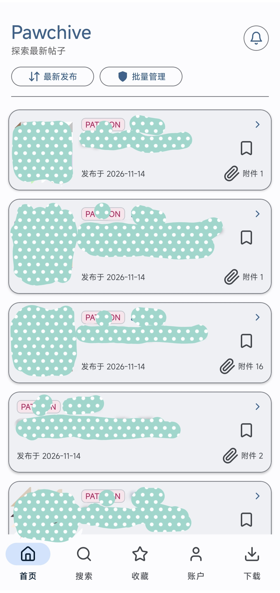
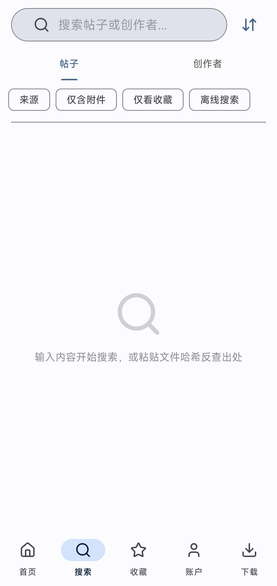
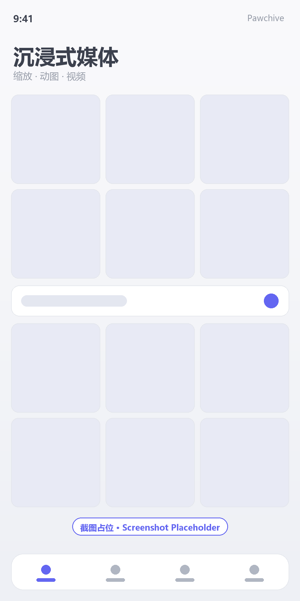
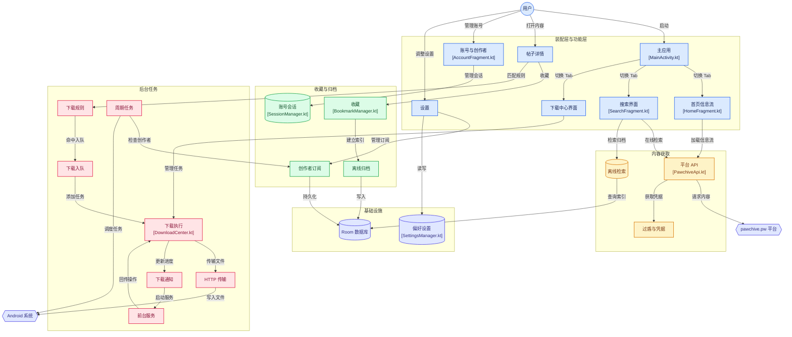

<p align="center">
  
</p>

<h1 align="center">Pawchive</h1>

<p align="center">
  <a href="README.en.md">English</a> | <a href="README.ja.md">日本語</a>
</p>

<p align="center">
  以 <b>极致轻量简洁</b> 为核心的第三方 Android 客户端，聚合 Patreon、Fanbox、Discord 等平台的创作者内容。<br/>
  克制的功能边界、零冗余依赖：安装包约 15 MB，专注浏览、搜索、收藏与沉浸式媒体播放。
</p>

<p align="center">
  
  
</p>

<p align="center">
  
  
  
  
  
  <a href="https://t.me/Pawchive_Archive"></a>
  <a href="https://github.com/Aerunox/Archive"></a>
</p>

> [!IMPORTANT]
> 🚀 **新世代项目**：Pawchive 1.9.0 为本仓库的**最终版本**，项目已停止更新（EOL），不再发布缺陷与安全修复。后续开发已迁移至新世代仓库 **[Aerunox/Archive](https://github.com/Aerunox/Archive)**，欢迎前往关注与 Star。
>
> 📢 **Telegram 频道**：加入 [Pawchive Archive](https://t.me/Pawchive_Archive) 获取版本发布与项目动态。

> [!NOTE]
> 本项目为**非官方第三方客户端**，与 `pawchive.pw` 运营方无隶属或合作关系；应用本身不托管、不分发任何内容，仅作为浏览与下载的客户端工具，内容版权归原作者与对应平台所有。因上游 API 变更导致的功能失效不在修复承诺范围内。

> [!TIP]
> **本项目与 [Aerunox/Archive](https://github.com/Aerunox/Archive) 不是简单的版本先后关系，而是两条设计取向不同的产品线**：Pawchive 追求**极致轻量简洁**，Archive 追求**功能丰富**。选择哪一款取决于你更看重「小而快」还是「大而全」，详见下方[设计取向与对比](#设计取向pawchive-vs-archive)。
>
> 两者并非完全独立：Archive 直接复用了本仓库的 `core` / `data` 模块作为共同基座，只重写了 UI 层。本仓库是那份基座的**原始出处**。

---

## 设计取向：Pawchive vs Archive

两个项目同源，但设计目标相反。Pawchive 是**减法**的产物，Archive 是**加法**的产物——后者直接复用了本仓库的 `core` / `data` 模块作为共同基座，只重写 UI 层。

| 维度 | **Pawchive**（本仓库） | **[Archive](https://github.com/Aerunox/Archive)** |
| --- | --- | --- |
| **设计取向** | 🪶 极致轻量简洁 | 🧰 功能丰富、能力齐全 |
| **核心信条** | 只保留最高频的能力，不为低频需求付出体积与认知成本 | 尽可能覆盖所有使用场景，功能密度优先 |
| **同源关系** | `core` / `data` 模块的**原始出处** | 直接复用 Pawchive 的 `core` / `data`，仅重写 `app` 层 |
| **UI 框架** | XML + ViewBinding，Material Design 3 | Jetpack Compose（BOM 2026.09.00）+ Miuix 0.9.4（HyperOS 风格） |
| **模块划分** | 10 个 Gradle 模块，按 `feature-*` 逐功能拆分 | 3 个 Gradle 模块（`app` / `data` / `core`） |
| **代码规模** | 150 个 Kotlin 文件 · 约 2.7 万行 | 188 个 Kotlin 文件 · 约 3.5 万行 |
| **依赖数量** | 37 个第三方库 | 47 个第三方库 |
| **构建工具链** | AGP 9.3.2 · Gradle 9.5.1 · JDK 17 | AGP 9.4.1 · Gradle 9.8.0 · JDK 21 |
| **安装包体积** | 约 **15 MB**（universal 单包） | 约 **35–97 MB**（按 ABI 拆包，universal 约 97 MB） |
| **AI 能力** | ❌ 不内置 | ✅ 多供应商 AI（OpenAI / Anthropic / Gemini）、多模型档案、结构保真翻译 |
| **OCR 文字识别** | ❌ 不内置 | ✅ 端上 PP-OCRv4（PaddleOCR + ONNX Runtime） |
| **多语言** | 简体中文 / English / 日本語（3 种） | 12 种语言（含阿拉伯语整页 RTL） |
| **外观定制** | 默认 + 5 套强调色，Material You 动态取色 | 配色 6 态、Monet 动态取色 + 种子色、即时切换 |
| **应用内更新** | ❌ 已移除（1.9.0 起） | ✅ 内置 GitHub Release 检查 |
| **自动化测试** | 27 个单元测试类 + 1 个仪器化套件 | 19 个单元测试类 |
| **项目状态** | 🔒 1.9.0 为最终版本，已 EOL | 🚀 持续开发中 |
| **开源协议** | MIT | GPL-3.0 |

> 两套数字均取自各自仓库的实际配置文件与发布产物（Pawchive 1.9.0 / Archive 1.0.2），非估算。

**怎么选？**

- 想要一个**装完就走、不占空间、打开即用**的浏览工具 → 选 **Pawchive**
- 想要 **OCR 识字、AI 翻译、发现页全量创作者、12 语言界面、Monet 深度定制**等能力 → 选 **[Archive](https://github.com/Aerunox/Archive)**

---

## 界面预览

<p align="center">
  
  
  
  
</p>

<p align="center">
  <sub>首页信息流 · 实时搜索 · 账号中心 · 下载中心</sub>
</p>

> 截图位于 `docs/screenshots/`，尺寸统一为 1080 × 2282。替换为其他截图时保持同名同比例即可生效，无需改动本文件。

---

## 功能亮点

### 内容浏览
- **首页信息流**：分页加载最新内容，支持关键词筛选；可选「同作者仅显示一条」与「隐藏已收藏创作者的帖子」
- **创作者主页**：帖子 / 公告 / 关联账号 / 相似作者分页浏览（左右滑动切换），标签筛选、粉丝卡一览
- **帖子详情**：完整正文（白名单 HTML 渲染）、评论、修订历史、附件下载
- **多平台聚合**：Patreon / Fanbox / Discord 等来源，平台标签按品牌色区分

### 精准搜索
- **关键词搜索**：同时检索帖子与创作者，Tab 切换查看
- **文件哈希反查**：搜索框粘贴文件哈希（MD5 / SHA-256）追踪素材出处，支持 Discord 结果
- **离线全文搜索**：基于 Room FTS4 的中文分词索引，断网也能搜收藏内容
- **搜索历史**：本地持久化，保留条数可配置（5–50），支持单条删除与一键清空

### 沉浸式媒体
- **大图查看**：双指缩放、双击缩放、边界约束拖拽
- **动图播放**：GIF / 动画 WebP / 动画 HEIF，列表带「GIF」角标
- **视频播放**：Media3 ExoPlayer，Bilibili 风格控制器，倍速播放、断点续播；全屏与内嵌共用同一播放器实例，进出全屏零重新缓冲，画面等比缩放
- **多级回退**：原图优先，缺失时自动回退缩略图

### 收藏与账号
- **多账号切换**：账号间收藏 / 历史 / 下载数据隔离
- **云端收藏**：登录后同步收藏的帖子与创作者，写入后即时失效缓存；离线时操作自动排队，联网后后台补写
- **本地收藏**：无需登录，收藏即建立离线归档索引
- **离线阅读**：收藏帖全文归档（Room FTS4），断网可检索与阅读

### 内容订阅与通知
- **订阅创作者**：关注喜欢的创作者，新帖自动周期检测（间隔可调，最小 15 分钟）；可选「收藏即订阅」
- **系统通知**：检测到新帖即时推送，可随时关闭
- **应用内通知中心**：首页铃铛直达，未读数角标实时刷新；支持单条 / 全部已读，订阅管理页可随时退订

### 下载中心
- **HTTP Range 断点续传**：暂停保留临时文件，断点落库，应用重启后继续仍从断点续传；服务端不支持 Range 时自动降级为全量下载
- **独立任务通知**：每条任务一个通知，实时显示百分比 / 已下载大小 / 速度（EMA 平滑）/ 剩余时间，通知内可暂停、继续、取消
- **后台持续下载**：`dataSync` 前台服务保活，切后台不中断
- **下载规则**：按创作者 / 服务 / 文件类型自动入队
- **合规约束**：并发上限钳制 5、同文件重试间隔 ≥1 秒、自定义可识别 User-Agent

### 个性化设置
- **多语言**：中文 / English / 日本語，实时切换
- **外观**：日间 / 夜间 / 跟随系统，默认主题 + 5 套强调色主题（共 6 种配色），Material Design 3；Android 12+ 支持动态取色（Material You）；沉浸式状态栏
- **显示与缩放**：整体 UI 缩放与全局文字大小滑杆，实时预览、即时生效；网格列数（1–3 列）、可关闭全部动效
- **省流量**：列表默认加载缩略图，可切换为原图
- **下载参数**：自定义下载目录（SAF）、最大并发数（1–5）、重试次数（1–3）、仅 Wi-Fi 下载、文件命名格式
- **自动备份**：每日导出备份到所选目录
- **应用内更新**：1.9.0 为最终版本，此后停止更新，GitHub 更新检查链路已整体移除

---

## 技术架构

| 类别 | 技术选型 | 说明 |
|------|---------|------|
| **语言** | Kotlin | 由 AGP 9.3.2 内置，无需单独应用 Kotlin Gradle 插件；字节码目标 JVM 17 |
| **最低 SDK** | API 30 (Android 11) | 覆盖绝大多数活跃设备 |
| **目标 / 编译 SDK** | API 36 (minorApiLevel 1) | 最新 Android 版本 |
| **UI 框架** | XML + ViewBinding | 声明式布局，类型安全访问（非 Compose） |
| **设计语言** | Material Design 3 | 卡片分组、分段按钮、品牌色标签、动态取色 |
| **模块化** | 10 个 Gradle 模块 | `app` / 7×`feature-*` / `data` / `core` |
| **依赖注入** | Hilt 2.59.2 + KSP 2.3.6 | `@HiltAndroidApp` / `@AndroidEntryPoint` / `HiltWorkerFactory` |
| **本地存储** | Room 2.8.4 + DataStore 1.1.1 | 下载历史 / 离线归档 FTS4 用 Room，设置用 DataStore |
| **安全存储** | security-crypto 1.1.0 | `EncryptedSharedPreferences` 保存 `cf_clearance` 与会话凭据 |
| **下载引擎** | 自研 OkHttp 流式下载 | 1.7.0 起替换 okdownload，单连接单请求 + Range 断点续传 |
| **网络层** | Retrofit 2.9.0 + OkHttp 4.12.0 | 类型安全 HTTP 客户端 + 自定义拦截器链 |
| **图片加载** | Coil 2.6.0 + coil-gif | 协程原生，注册 `ImageDecoderDecoder` 支持动图 |
| **视频播放** | AndroidX Media3 1.4.1 | ExoPlayer + OkHttp 数据源 |
| **导航** | 单 Activity + ViewPager2 1.1.0 | 底部导航与横向滑动双向联动 |
| **后台任务** | WorkManager 2.12.0 + Hilt | 周期订阅同步、自动备份、缓存清理 |
| **构建工具** | Gradle 9.5.1 + AGP 9.3.2 | 版本目录（`libs.versions.toml`）统一管理 |
| **质量门禁** | Kover 0.9.9 | 核心层（core + data）行覆盖率 ≥ 45% |

### 架构总览

模块协作与数据流向图：



---

## 核心技术亮点

### 1. Cloudflare 托管挑战自动过盾

目标站点启用 Cloudflare 防护，纯 OkHttp 请求会被拦截返回 403。`CloudflareManager` 通过隐藏 WebView 执行 JS 挑战，提取 `cf_clearance` Cookie 并**与其绑定的 User-Agent 一起**注入后续所有 OkHttp 请求：

- **单飞机制**：并发调用复用同一个 `CompletableDeferred`，不会并发启动多个 WebView
- **凭据持久化**：加密存储（EncryptedSharedPreferences）保存凭据，25 分钟 TTL 内冷启动免过盾
- **强制剔除 `session` 段**：WebView 写入的匿名 session 会与真实登录会话叠加导致 401 误判，注入前一律剥离
- **加固**：构造与配置整体降级保护（第三方 WebView 实现抛 `Error` 也不闪退）、覆写 `onRenderProcessGone` 防止渲染进程崩溃连带杀死应用

### 2. 直连 OkHttp 流式下载引擎

1.7.0 起移除 okdownload（源码级取证：sync 线程无超时阻塞、多块并发请求违反服务器限流要求、断点校验在响应截断时抛隐晦错误），改为单连接流式下载：

- **暂停 / 续传**：暂停保留临时文件，继续时以 `Range: bytes=N-` 续传；服务端忽略 Range 返回 200 时静默降级为全量下载
- **截断检测**：按 `Content-Length` 与实际读取字节数比对，响应截断时快速失败并退避重试
- **可中断**：读循环每 64 KB 检查协程活跃性，取消能即时打断下载与写出两个阶段
- **临时文件隔离**：先落临时文件、成功后一次性拷到目标流，重试不会污染已写出的字节
- **四类客户端分离**：下载客户端不设 `callTimeout`（否则 60 秒传不完的文件会被看门狗掐断），且不挂内存缓存拦截器

### 3. 智能拦截器链

- **凭据注入**：仅对主域 `pawchive.pw` 注入 Cookie + Referer + UA；CDN 子域只注入 UA（避免触发防盗链、避免泄露凭据）
- **403 兜底**：`ClearanceRetryInterceptor` 在 403 时强制刷新过盾并重试一次
- **日志脱敏**：`Authorization` / `Cookie` / `Set-Cookie` 始终以掩码输出，release 下日志级别关闭
- **账号维度缓存**：GET JSON 响应缓存 5 分钟，键含 session hash 命名空间（杜绝跨账号复用），支持按路径精准失效

### 4. 单 Activity + 模块化导航

- 底部导航与 **ViewPager2** 双向联动，主 Tab 跟随手指滑动切换
- `offscreenPageLimit = 1`：避免首页与收藏页同时预加载、竞争同一个过盾任务
- **AppNavigator 接口**：各 feature 通过接口导航，模块间零直接依赖

### 5. 离线归档与全文检索

- 收藏即写入 Room 实体表 + FTS4 影子表，事务保证两者一致
- **CJK bigram 分词**：中文无需空格也能命中
- **相关性加权**：标题 > 创作者 > 正文 / 附件，分层检索后按权重顺序合并去重

### 6. 性能与体验

- **骨架屏**：自定义 `SkeletonHelper` 实现 shimmer 脉冲动画，可全局关闭（减少动效）
- **启动路径零阻塞**：语言 / 外观 / 缩放读轻量 SharedPreferences 启动缓存，不碰 DataStore
- **内存快照 + 异步落盘**：设置与收藏读内存、写异步，UI 即时响应

---

## 项目结构

```
Pawchive/
├── app/                    # 装配层：Application / MainActivity / 主 Pager
├── feature-common/         # 共享 UI：SkeletonHelper / ZoomableImageView / 通用 adapter / AppNavigator
├── feature-home/           # 首页信息流
├── feature-search/         # 搜索（在线 + 离线全文）
├── feature-post/           # 帖子详情 / 大图查看 / 视频播放
├── feature-downloads/      # 下载中心
├── feature-settings/       # 设置（含下载规则、订阅、备份、缓存管理）
├── feature-account/        # 账号 / 登录 / 收藏
├── data/                   # 业务层：Repository / 下载引擎 / Worker
├── core/                   # 基础设施：网络 / 模型 / Room / DataStore / 工具
└── gradle/libs.versions.toml   # 版本目录（依赖单一事实来源）
```

**依赖方向**：`:app` → `:feature-*` → `:data` → `:core`

规模概览：150 个 Kotlin 源文件（约 2.7 万行）、42 个布局文件、27 个单元测试类 + 1 个仪器化测试套件。

---

## 快速开始

### 环境要求
- **Android Studio** Meerkat (2024.3+) 或更高
- **JDK** 17（`compileOptions` 的 `sourceCompatibility` / `targetCompatibility` 均为 `VERSION_17`；各模块脚本未显式声明 `jvmTarget`，Kotlin 字节码目标由 AGP 9.3.2 内置编译器决定）
- **Gradle** 9.5.1（项目内置 wrapper，含 `distributionSha256Sum` 完整性校验，无需手动安装）

### 克隆 & 构建

```bash
git clone https://github.com/Aerunox/Pawchive.git
cd Pawchive
./gradlew assembleRelease
```

> APK 输出路径：`app/build/outputs/apk/release/Pawchive-v<版本号>.apk`
> （文件名取自 `gradle.properties` 的 `VERSION_NAME`；该文件是版本号唯一来源，缺失或非法时构建直接失败）
>
> 未提供 `keystore.properties` 时，release 变体自动回退使用 debug 签名，方便本地自构建；正式分发请自备签名文件。

### 常用任务

```bash
./gradlew testDebugUnitTest                       # 单元测试
./gradlew koverVerify koverHtmlReport             # 覆盖率门禁与报告
./gradlew lintDebug                               # Lint
```

### 安装

下载最新 APK（[Releases · v1.9.0](https://github.com/Aerunox/Pawchive/releases/tag/v1.9.0)），安装到 Android 11+ 设备即可。

---

## 权限说明

| 权限 | 用途 |
|------|------|
| `INTERNET` | 网络请求 |
| `ACCESS_NETWORK_STATE` | 网络状态检测（仅 Wi-Fi 下载、网络可用性判断） |
| `POST_NOTIFICATIONS` | 下载进度通知与内容更新通知（Android 13+ 运行时申请；拒绝后下载与浏览不受影响） |
| `FOREGROUND_SERVICE` | 下载前台服务 |
| `FOREGROUND_SERVICE_DATA_SYNC` | 下载前台服务类型（Android 14+ 强制声明，保证后台下载不被中断） |
| `WRITE_EXTERNAL_STORAGE` | 仅 API ≤ 28 声明，新系统走 MediaStore / SAF 无需此权限 |
| `ACCESS_MEDIA_LOCATION` | 仅 API ≤ 32 声明，读取媒体位置元数据 |

---

## 工程质量

| 机制 | 说明 |
|------|------|
| **版本单一来源** | `gradle.properties` 的 `VERSION_NAME` / `VERSION_CODE` 是全项目唯一版本来源：`:app` 经 `requireNotNull` 强制校验（缺失或非法即构建失败，不提供兜底），`:feature-common` 通过 `buildConfigField` 共享同一属性 |
| **依赖单一来源** | 依赖版本统一收口在 `gradle/libs.versions.toml` 版本目录 |
| **覆盖率棘轮** | 核心层（core + data）行覆盖率下限 45%，只增不减；`./gradlew koverVerify` 跌破即失败 |
| **构建可复现** | Gradle wrapper 固定 9.5.1 并校验 `distributionSha256Sum`；依赖仓库优先走镜像，规避官方源 TLS 握手失败 |
| **R8 混淆与资源压缩** | release 启用 `isMinifyEnabled` + `isShrinkResources`，`mapping.txt` 输出至 `app/build/outputs/mapping/release/`，用于线上崩溃反混淆 |
| **签名降级保护** | 存在 `keystore.properties` 时使用 release 签名，否则回退 debug 签名，保证外部贡献者可自行构建 |
| **静态检查** | `lintDebug`；`app/src/main/lint.xml` 全局 opt-in Media3 `UnstableApi`，仅关闭 `UnsafeOptInUsageError` |
| **自动化测试** | 27 个单元测试类（core 15 / data 12）+ 1 个仪器化测试套件，基于 Robolectric 4.14.1 |
| **崩溃诊断** | 全局 `CrashHandler` 落盘崩溃日志，经 FileProvider 分享导出 |
| **三语文案对齐** | `core` / `data` / `feature-common` 三模块的 `values/`、`values-en/`、`values-ja/` 字符串 key 全量对齐（449 / 29 / 15 条） |

---

## 已知边界

以下限制属设计决定或平台约束，不作为缺陷受理：

1. **Android 15+ 前台服务时长上限**：`dataSync` 前台服务受系统「24 小时内累计 6 小时」上限约束，超长挂机下载会被系统中断，需手动继续
2. **WebView 内容不随应用内缩放设置变化**：UI 缩放作用于原生界面，网页内容使用自身视口密度
3. **上游服务变更**：本应用不控制 `pawchive.pw` 的 API 与反爬策略，上游单方面变更可能导致功能不可用

---

## 支持与安全

| 文档 | 内容 |
|------|------|
| [SUPPORT.md](SUPPORT.md) | 支持窗口、更新节奏、系统要求、已知边界、EOL 政策 |
| [SECURITY.md](SECURITY.md) | 漏洞报告渠道与响应时限、安全设计说明 |
| [CHANGELOG.md](CHANGELOG.md) | 版本变更记录 |
| [NOTICE.md](NOTICE.md) | 第三方组件与许可声明 |

> ⚠️ 1.9.0 起项目已停止更新（EOL）：不再发布缺陷与安全修复，应用内更新检查已移除；存量用户仍可继续使用并手动安装 Release 页面提供的 APK。

---

## 社区与后续

| 渠道 | 说明 |
| --- | --- |
| [Telegram 频道 · Pawchive Archive](https://t.me/Pawchive_Archive) | 版本发布公告与项目动态，两个项目共用 |
| [新世代仓库 · Aerunox/Archive](https://github.com/Aerunox/Archive) | 本项目的下一世代版本，后续开发与更新在此进行（GPL-3.0） |

Archive 沿用本项目的 `core` / `data` 基座（网络层、Cloudflare 过盾、下载引擎、Room 与加密会话），并在其上重建了 Compose + Miuix 的 UI 层，同时新增 AI 翻译、端上 OCR、发现页全量创作者缓存、12 语言本地化等能力。如果你需要的就是这些能力，请直接使用 [Archive](https://github.com/Aerunox/Archive)；如果你只需要一个够快够小的客户端，本仓库的 1.9.0 仍是可用且完整的最终版本。

---

## 贡献

欢迎提交 Issue 和 Pull Request。提交前请确保：

1. 代码风格与现有代码保持一致（`kotlin.code.style=official`）
2. 新增文案同步维护三套字符串资源（`core` / `data` / `feature-common` 下的 `values/`、`values-en/`、`values-ja/` key 需对齐）
3. 遵循 Material Design 3 设计规范
4. 核心层新增逻辑附带单元测试，不使覆盖率跌破门禁

---

## Star 趋势

<p align="center">
  <a href="https://star-history.com/#Aerunox/Pawchive&Date">
    <picture>
      <source media="(prefers-color-scheme: dark)" srcset="https://api.star-history.com/svg?repos=Aerunox/Pawchive&type=Date&theme=dark" />
      <source media="(prefers-color-scheme: light)" srcset="https://api.star-history.com/svg?repos=Aerunox/Pawchive&type=Date" />
      
    </picture>
  </a>
</p>

<p align="center">
  <sub>本项目已归档（1.9.0 为最终版），Star 数趋于平稳；如需关注后续开发，请移步 <a href="https://github.com/Aerunox/Archive">Aerunox/Archive</a>。</sub>
</p>

---

## 开源协议

本项目基于 **MIT License** 开源，Copyright (c) 2024-2026 FengByX。第三方组件与图标授权详见 [NOTICE.md](NOTICE.md)。

**与本项目代码复用相关的说明**：下一世代项目 [Archive](https://github.com/Aerunox/Archive) 直接复用了本仓库的 `core` / `data` 模块（同一作者），该两模块在 Archive 中随其整体转为 GPL-3.0 发布。如果你希望**闭源使用或二次分发**，应以本仓库的 MIT 版本为基线。

---

<p align="center">
  <sub>图标资源来自 <a href="https://lucide.dev">Lucide</a> · 设计灵感来自 Material Design 3 · 数据来自 <a href="https://pawchive.pw">Pawchive</a> 平台（本项目为非官方客户端）</sub>
</p>
